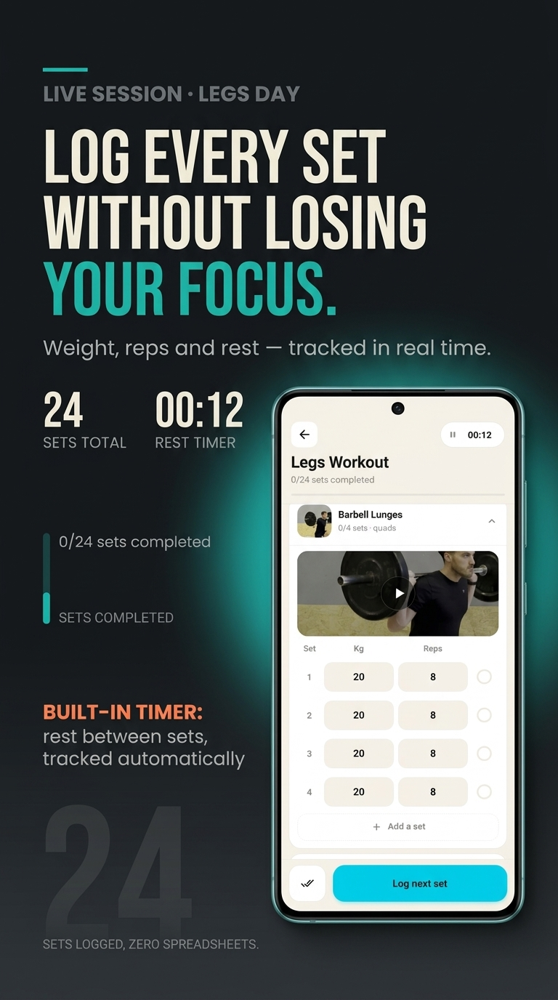
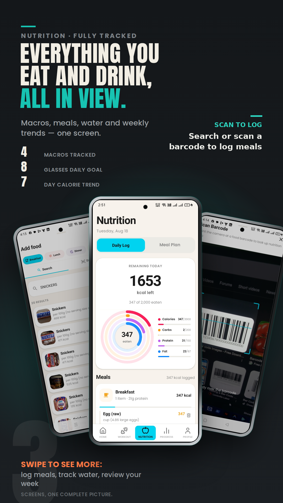
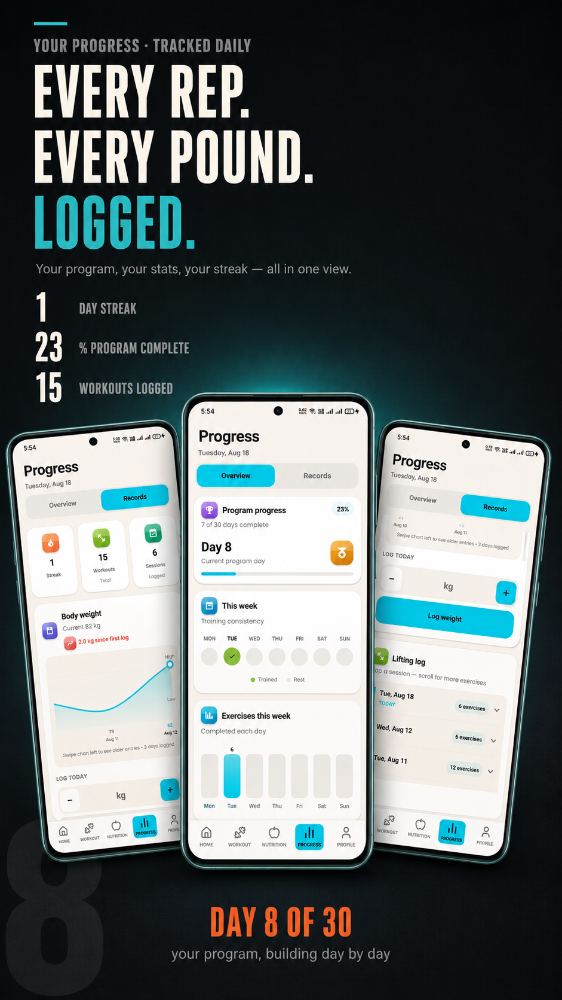
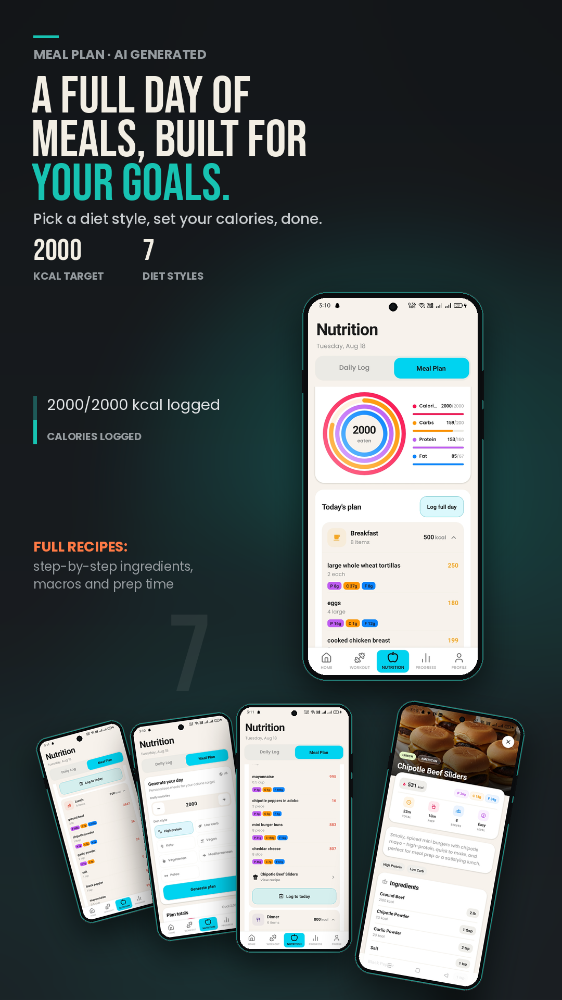
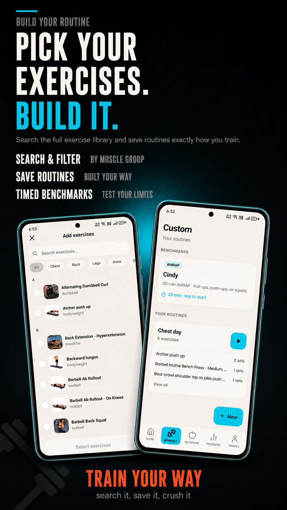

**Full-stack & React Native developer**

React interfaces. Node.js APIs. Mobile experiences.

Multan, Pakistan · Open to developer roles and collaborations

[Featured project](#featured-project--gympro) &nbsp; / &nbsp; [Tech stack](#tech-stack) &nbsp; / &nbsp; [LinkedIn](https://linkedin.com/in/haris-ali-asghar-a) &nbsp; / &nbsp; [Get in touch](mailto:haris.asghar.developer@gmail.com)

 

I’m Haris. I build web and mobile applications with React, React Native, and Node.js. My current focus is **GymPro**: bringing workout planning, session logging, nutrition, and progress into one mobile experience.

I’m interested in the work behind the interface, too: authentication, backend development, and automated build checks.

---

## Featured project · GymPro

**Plan your training. Log the work. See your progress.**

A fitness app built with **React Native, Expo, and Firebase**, with GitHub Actions and Fastlane in the development workflow.

**Private repository** · Product showcase below

<table>
  <tr>
    <td width="33%" align="center"></td>
    <td width="33%" align="center"></td>
    <td width="33%" align="center"></td>
  </tr>
  <tr>
    <td align="center"><strong>Train with focus</strong> Sets, reps, weights, and rest</td>
    <td align="center"><strong>Make nutrition visible</strong> Food search, scanning, and macros</td>
    <td align="center"><strong>Follow your progress</strong> Consistency, trends, and history</td>
  </tr>
</table>

Select any image for a closer look. Screens show example in-app data.

### What you can do

- **Log a workout as you train.** Record weights and reps per set, mark completion, add sets, and follow a built-in rest timer.
- **Track nutrition in one place.** Search foods or scan a barcode, log meals, and review calorie and macro totals.
- **See progress over time.** Review program completion, weekly training activity, body-weight trends, and lifting history.
- **Build your own routines.** Search and filter exercises by muscle group, save routines, and launch timed benchmarks.
- **Plan meals around your preferences.** Choose a calorie target and diet style, generate a meal plan, explore recipes, and log meals to the day.

<strong>Explore meal planning and custom routines</strong>

 

<table>
  <tr>
    <td width="50%" align="center"></td>
    <td width="50%" align="center"></td>
  </tr>
</table>

### Behind the app

`React Native` `Expo` `Firebase` `GitHub Actions` `Fastlane`

- **Mobile:** React Native and Expo for the application.
- **Authentication:** Firebase authentication.
- **Build workflow:** Automated lint and build checks through GitHub Actions, with Fastlane in the toolchain.

Interested in the project or my approach? [Let’s talk →](mailto:haris.asghar.developer@gmail.com?subject=Let%27s%20talk%20about%20GymPro)

---

## Also on my workbench

**AI Voice Assistant** · In development  
Exploring voice-driven interaction with Node.js, natural language processing, and real-time responses.

**Currently learning**  
Node.js internals, JWT authentication patterns, and cloud deployment, including AWS fundamentals.

## Contributions in motion

<picture>
  <source media="(prefers-color-scheme: dark)" srcset="https://raw.githubusercontent.com/HarisAliB15/HarisAliB15/main/assets/github-snake-dark.svg">
  <source media="(prefers-color-scheme: light)" srcset="https://raw.githubusercontent.com/HarisAliB15/HarisAliB15/main/assets/github-snake.svg">
  
</picture>

Refreshed daily with GitHub Actions · Animation by <a href="https://github.com/Platane/snk">Platane/snk</a>

---

## Tech stack

| Area | Tools |
| :--- | :--- |
| **Mobile** | React Native · Expo |
| **Web** | React · TypeScript · JavaScript · Tailwind CSS |
| **Backend & data** | Node.js · Express · MongoDB · Firebase |
| **Delivery** | Git · GitHub Actions · Fastlane · Vercel · Render |

Additional languages

Python · Java · C++

---

### Let’s build something useful.

Open to **React Native** and **full-stack development** opportunities.

**[Email](mailto:haris.asghar.developer@gmail.com)** &nbsp; · &nbsp; **[LinkedIn](https://linkedin.com/in/haris-ali-asghar-a)** &nbsp; · &nbsp; **[GitHub](https://github.com/HarisAliB15)**

From Multan, Pakistan — building, learning, and improving with every project.

